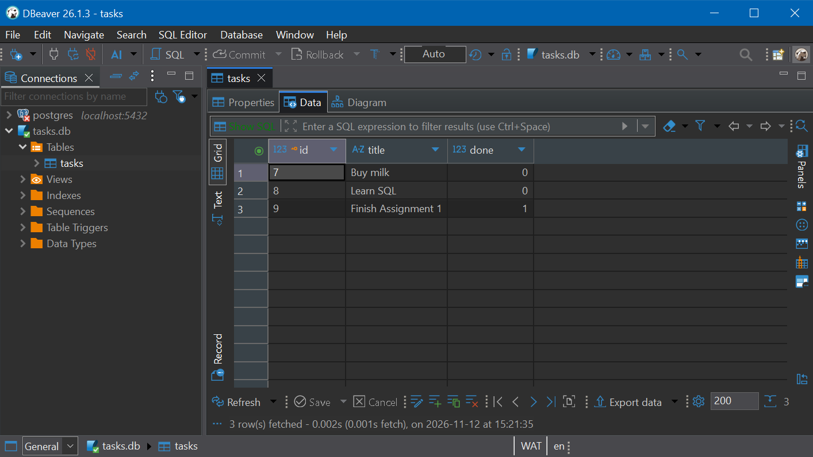

# Task API with SQLite

A small CRUD API for a to-do list, built with **TypeScript**, **Express** and **SQLite**
(via [`better-sqlite3`](https://github.com/WiseLibs/better-sqlite3)).

The endpoints are the same as in Assignment 1. The difference is in storage: tasks
used to live in an in-memory array, and now they are saved in a SQLite database, so
they are still there after the server restarts.

```
Before:  Client -> API -> Array in memory
Now:     Client -> API -> SQLite database (tasks.db)
```

## Getting started

Requirements: **Node.js 20 or newer** and npm.

```bash
git clone <this-repo-url>
cd connecting-db-w3
npm install
npm run dev
```

The API runs at `http://localhost:3000`. To use another port, set the `PORT`
environment variable.

On first start, the app:

1. creates the database file `tasks.db` if it doesn't exist,
2. creates the `tasks` table if it doesn't exist, and
3. inserts three example tasks, but only when the table is empty.

You don't have to set anything up by hand.

| Script | What it does |
|---|---|
| `npm run dev` | Start with auto-reload (tsx) |
| `npm run build` | Compile TypeScript to `dist/` |
| `npm start` | Run the compiled build |
| `npm run typecheck` | Type-check without writing any files |

## Why SQLite?

- **No setup.** There is no database server to install, run or configure. The whole
  database is one file.
- **Real SQL.** The tables, queries, primary keys and constraints are the same ideas
  used in PostgreSQL or MySQL, so what I learn here carries over.
- **Good fit for the job.** A small API with one user at a time doesn't need a
  database server. SQLite is fast and reliable at this size.
- **Easy to inspect.** The file opens directly in a database tool such as DBeaver.

## Where the database is stored

The database is the file **`tasks.db` in the project root** (next to `package.json`).
To use a different file, set `DB_PATH`, for example `DB_PATH=dev.db npm run dev`.

`tasks.db` is listed in `.gitignore`. Every clone gets its own fresh database the
first time it runs.

Schema:

```sql
CREATE TABLE IF NOT EXISTS tasks (
  id    INTEGER PRIMARY KEY AUTOINCREMENT,
  title TEXT    NOT NULL,
  done  BOOLEAN NOT NULL DEFAULT 0 CHECK (done IN (0, 1))
);
```

SQLite has no real boolean type, so `done` is stored as `0` or `1`. The API turns it
into `true` or `false` in JSON responses.

## API

| Method | Path | Body | Success | Errors |
|---|---|---|---|---|
| `GET` | `/tasks` | none | `200` with an array of tasks | none |
| `GET` | `/tasks/:id` | none | `200` with the task | `404` |
| `POST` | `/tasks` | `{ "title": string, "done"?: boolean }` | `201` with the created task | `400` |
| `PUT` | `/tasks/:id` | `{ "title"?: string, "done"?: boolean }`, at least one field | `200` with the updated task | `400`, `404` |
| `DELETE` | `/tasks/:id` | none | `204`, no content | `404` |

An unknown id returns `404 { "error": "Task not found" }`. An invalid body (missing or
empty title, a `done` that isn't a boolean, or malformed JSON) returns `400` with an
`error` message.

```bash
curl http://localhost:3000/tasks
curl -X POST http://localhost:3000/tasks -H "Content-Type: application/json" -d '{"title":"Walk the dog"}'
curl -X PUT http://localhost:3000/tasks/1 -H "Content-Type: application/json" -d '{"done":true}'
curl -X DELETE http://localhost:3000/tasks/1
```

## Project structure

```
src/
  server.ts          starts the HTTP server and opens the database
  app.ts             Express routes (the API layer)
  taskRepository.ts  all SQL queries (the data layer)
  validation.ts      request body validation
  db.ts              opens tasks.db, creates the table, seeds example tasks
queries.sql          the SQL I ran by hand in Stage 4
```

Only `taskRepository.ts` and `db.ts` know about SQL. The routes call methods such as
`tasks.findAll()` and `tasks.create()`, so switching to PostgreSQL or MySQL would mean
rewriting those two files and leaving the API unchanged.

## Exploring the database by hand

I opened `tasks.db` in **DBeaver** (New Database Connection → SQLite → path to
`tasks.db`) and ran the queries in [`queries.sql`](queries.sql) in its SQL editor
while the API was running. Auto-commit was on, so each change was saved immediately:



One example query, marking every task as completed:

```sql
UPDATE tasks SET done = 1;
```

Straight after that, `GET /tasks` returned every task with `"done": true`, with no
restart. The API reads from the database on every request, so a change made outside
the app shows up immediately. Running `DELETE FROM tasks WHERE done = 1;` next emptied
the table, and `GET /tasks` returned `[]`.

> Note: the example tasks are inserted whenever the table is **empty** at startup.
> If you delete every row by hand, the three examples come back on the next restart.
> Their ids continue from where they stopped (for example 7, 8, 9) because
> `AUTOINCREMENT` never reuses an id.
